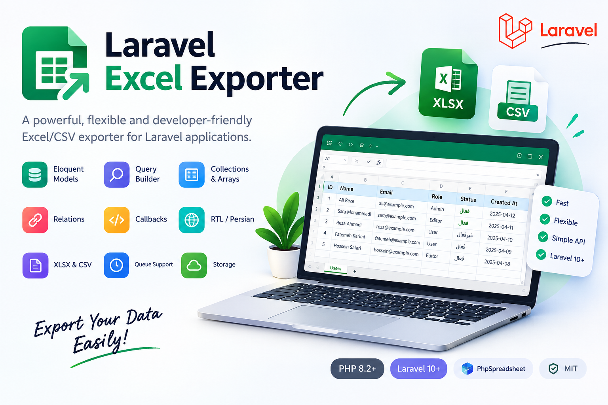

# Laravel Excel Exporter

[](https://packagist.org/packages/abolfazrastegar/laravel-excel-exporter)
[](https://packagist.org/packages/abolfazrastegar/laravel-excel-exporter)
[](LICENSE)
[](https://www.php.net/)

A powerful, flexible and developer-friendly Excel/CSV exporter for Laravel applications.

Built on top of [PhpSpreadsheet](https://github.com/PHPOffice/PhpSpreadsheet), this package provides a fluent API for exporting:

* Eloquent Models
* Eloquent Query Builder
* Laravel Query Builder
* Collections
* Arrays
* Iterables
* Nested relationships
* Custom callbacks
* XLSX files
* CSV files
* Large datasets
* Queue-based exports
* RTL / Persian Excel files

---

## Table of Contents

* [Requirements](#requirements)
* [Installation](#installation)
* [Basic Usage](#basic-usage)
* [Export an Eloquent Model](#export-an-eloquent-model)
* [Export a Query Builder](#export-a-query-builder)
* [Export an Array](#export-an-array)
* [Export a Collection](#export-a-collection)
* [CSV Export](#csv-export)
* [Persian / RTL Excel](#persian--rtl-excel)
* [Freeze Header](#freeze-header)
* [Auto Filter](#auto-filter)
* [Column Width](#column-width)
* [Auto Size Columns](#auto-size-columns)
* [Nested Relationships](#nested-relationships)
* [Multiple Nested Relationships](#multiple-nested-relationships)
* [Custom Column Callback](#custom-column-callback)
* [Boolean Values](#boolean-values)
* [Date Formatting](#date-formatting)
* [Sheet Name](#sheet-name)
* [File Name](#file-name)
* [Store Exported File](#store-exported-file)
* [Complete Persian Example](#complete-persian-example)
* [Large Dataset](#large-dataset)
* [Facade](#facade)
* [Available Methods](#available-methods)

    * [Data](#data)
    * [Columns](#columns)
    * [Output Type](#output-type)
    * [Worksheet](#worksheet)
    * [RTL](#rtl)
    * [Freeze Header](#freeze-header)
    * [Filter](#filter)
    * [Auto Size](#auto-size)
    * [File Name](#file-name)
    * [Download](#download)
    * [Store](#store)
* [Example API Controller](#example-api-controller)
* [Example with Filters](#example-with-filters)
* [Testing](#testing)
* [Code Quality](#code-quality)
* [Laravel Compatibility](#laravel-compatibility)
* [Architecture](#architecture)
* [Performance Recommendations](#performance-recommendations)
* [Contributing](#contributing)
* [Security](#security)
* [License](#license)
* [Author](#author)
* [Changelog](#changelog)
* [Roadmap](#roadmap)
* [Support the Project](#-support-the-project)


## Requirements

* PHP `^8.2`
* Laravel `10.x`
* Laravel `11.x`
* Laravel `12.x`
* Laravel `13.x`
* PhpSpreadsheet `^5.9`

> Laravel 10+ is supported.

---

# Installation

Install the package using Composer:

```bash
composer require abolfazrastegar/laravel-excel-exporter
```

Laravel Package Discovery automatically registers the service provider and facade.

No additional configuration is required for basic usage.

---

# Basic Usage

The package provides a fluent API.

```php
use ARExcel;

return ARExcel::make()
    ->from(User::query())
    ->columns([
        'id' => 'ID',
        'name' => 'Name',
        'email' => 'Email',
    ])
    ->xlsx()
    ->download();
```

This creates an XLSX file and downloads it to the browser.

---

# Export an Eloquent Model

```php
use App\Models\User;
use ARExcel;

return ARExcel::make()
    ->from(User::query())
    ->columns([
        'id' => 'ID',
        'name' => 'Name',
        'email' => 'Email',
    ])
    ->xlsx()
    ->filename('users.xlsx')
    ->download();
```

---

# Export a Query Builder

```php
use Illuminate\Support\Facades\DB;
use ARExcel;

return ARExcel::make()
    ->from(
        DB::table('users')
            ->select([
                'id',
                'name',
                'email',
            ])
    )
    ->columns([
        'id' => 'ID',
        'name' => 'Name',
        'email' => 'Email',
    ])
    ->xlsx()
    ->download();
```

---

# Export an Array

You can export normal PHP arrays.

```php
$data = [
    [
        'id' => 1,
        'name' => 'Abolfazl',
        'email' => 'abolfazl@example.com',
    ],
    [
        'id' => 2,
        'name' => 'Ali',
        'email' => 'ali@example.com',
    ],
];

return ARExcel::make()
    ->from($data)
    ->columns([
        'id' => 'ID',
        'name' => 'Name',
        'email' => 'Email',
    ])
    ->xlsx()
    ->download();
```

---

# Export a Collection

```php
$users = User::query()
    ->where('active', true)
    ->get();

return ARExcel::make()
    ->from($users)
    ->columns([
        'id' => 'ID',
        'name' => 'Name',
        'email' => 'Email',
    ])
    ->xlsx()
    ->download();
```

For large datasets, prefer using a Query Builder instead of loading the entire collection into memory.

---

# CSV Export

To export a CSV file:

```php
return ARExcel::make()
    ->from(User::query())
    ->columns([
        'id' => 'ID',
        'name' => 'Name',
        'email' => 'Email',
    ])
    ->csv()
    ->filename('users.csv')
    ->download();
```

The CSV writer includes UTF-8 BOM support, making Persian and Unicode data compatible with applications such as Microsoft Excel.

---

# Persian / RTL Excel

For Persian, Arabic and other right-to-left languages:

```php
return ARExcel::make()
    ->from(User::query())
    ->columns([
        'id' => 'شناسه',
        'name' => 'نام',
        'email' => 'ایمیل',
    ])
    ->xlsx()
    ->rtl()
    ->download();
```

The generated worksheet will use right-to-left layout.

---

# Freeze Header

Freeze the first row:

```php
return ARExcel::make()
    ->from(User::query())
    ->columns([
        'id' => 'شناسه',
        'name' => 'نام',
        'email' => 'ایمیل',
    ])
    ->xlsx()
    ->freezeHeader()
    ->download();
```

This is useful for large Excel files.

---

# Auto Filter

Enable Excel's header filter:

```php
return ARExcel::make()
    ->from(User::query())
    ->columns([
        'id' => 'شناسه',
        'name' => 'نام',
        'email' => 'ایمیل',
    ])
    ->xlsx()
    ->filter()
    ->download();
```

You can combine this with RTL and frozen headers:

```php
return ARExcel::make()
    ->from(User::query())
    ->columns([
        'id' => 'شناسه',
        'name' => 'نام',
        'email' => 'ایمیل',
    ])
    ->xlsx()
    ->rtl()
    ->freezeHeader()
    ->filter()
    ->download();
```

---

# Column Width

You can specify the width of each column:

```php
return ARExcel::make()
    ->from(User::query())
    ->columns([
        'id' => [
            'title' => 'شناسه',
            'width' => 10,
        ],

        'name' => [
            'title' => 'نام',
            'width' => 30,
        ],

        'email' => [
            'title' => 'ایمیل',
            'width' => 40,
        ],
    ])
    ->xlsx()
    ->download();
```

---

# Auto Size Columns

Auto-size columns based on their content:

```php
return ARExcel::make()
    ->from(User::query())
    ->columns([
        'id' => 'شناسه',
        'name' => 'نام',
        'email' => 'ایمیل',
    ])
    ->xlsx()
    ->autoSize()
    ->download();
```

Auto-size is disabled by default to avoid expensive width calculations on large datasets.

To disable it:

```php
->autoSize(false)
```

---

# Nested Relationships

Nested Eloquent relationships are supported.

For example:

```php
User::query()
    ->with('role')
```

Then:

```php
return ARExcel::make()
    ->from(
        User::query()->with('role')
    )
    ->columns([
        'id' => 'شناسه',
        'name' => 'نام',
        'role.name' => 'نقش',
    ])
    ->xlsx()
    ->download();
```

---

# Multiple Nested Relationships

```php
return ARExcel::make()
    ->from(
        Order::query()
            ->with([
                'user',
                'product.category',
            ])
    )
    ->columns([
        'id' => 'شماره سفارش',
        'user.name' => 'مشتری',
        'product.title' => 'محصول',
        'product.category.name' => 'دسته‌بندی',
    ])
    ->xlsx()
    ->download();
```

---

# Custom Column Callback

You can customize the exported value using a callback.

```php
return ARExcel::make()
    ->from(User::query())
    ->columns([
        'id' => 'شناسه',

        'name' => [
            'title' => 'نام',
            'value' => fn ($user) => strtoupper($user->name),
        ],
    ])
    ->xlsx()
    ->download();
```

---

# Boolean Values

Boolean values are automatically converted to:

```text
true  → بله
false → خیر
```

Example:

```php
return ARExcel::make()
    ->from(User::query())
    ->columns([
        'id' => 'شناسه',

        'name' => 'نام',

        'active' => [
            'title' => 'وضعیت',
        ],
    ])
    ->xlsx()
    ->download();
```

---

# Date Formatting

Date columns can specify a format:

```php
return ARExcel::make()
    ->from(User::query())
    ->columns([
        'id' => 'شناسه',

        'created_at' => [
            'title' => 'تاریخ ثبت',
            'format' => 'date',
        ],
    ])
    ->xlsx()
    ->download();
```

Available formats:

```text
date
datetime
boolean
```

---

# Sheet Name

You can define the worksheet name:

```php
return ARExcel::make()
    ->from(User::query())
    ->columns([
        'id' => 'شناسه',
        'name' => 'نام',
    ])
    ->sheet('Users')
    ->xlsx()
    ->download();
```

For Persian:

```php
->sheet('کاربران')
```

---

# File Name

```php
return ARExcel::make()
    ->from(User::query())
    ->columns([
        'id' => 'شناسه',
        'name' => 'نام',
    ])
    ->xlsx()
    ->filename('users.xlsx')
    ->download();
```

CSV:

```php
->filename('users.csv')
```

---

# Store Exported File

Instead of downloading the file, you can save it to a Laravel filesystem disk.

```php
ARExcel::make()
    ->from(User::query())
    ->columns([
        'id' => 'شناسه',
        'name' => 'نام',
        'email' => 'ایمیل',
    ])
    ->xlsx()
    ->store(
        'exports/users.xlsx',
        'public'
    );
```

For the local disk:

```php
ARExcel::make()
    ->from(User::query())
    ->columns([
        'id' => 'شناسه',
        'name' => 'نام',
    ])
    ->xlsx()
    ->store(
        'exports/users.xlsx',
        'local'
    );
```

---

# Complete Persian Example

A complete example for a Persian Laravel application:

```php
use App\Models\User;
use ARExcel;

public function exportUsers()
{
    return ARExcel::make()
        ->from(
            User::query()
                ->with('role')
                ->where('active', true)
        )
        ->columns([
            'id' => [
                'title' => 'شناسه',
                'width' => 10,
            ],

            'name' => [
                'title' => 'نام',
                'width' => 30,
            ],

            'mobile' => [
                'title' => 'موبایل',
                'width' => 20,
            ],

            'email' => [
                'title' => 'ایمیل',
                'width' => 40,
            ],

            'role.name' => [
                'title' => 'نقش',
                'width' => 20,
            ],

            'active' => [
                'title' => 'وضعیت',
            ],
        ])
        ->sheet('کاربران')
        ->xlsx()
        ->rtl()
        ->freezeHeader()
        ->filter()
        ->autoSize()
        ->filename('users.xlsx')
        ->download();
}
```

---

# Large Dataset

For large datasets, use a Query Builder:

```php
return ARExcel::make()
    ->from(
        User::query()
            ->with('role')
            ->orderBy('id')
    )
    ->columns([
        'id' => 'شناسه',
        'name' => 'نام',
        'email' => 'ایمیل',
        'role.name' => 'نقش',
    ])
    ->xlsx()
    ->download();
```

The exporter uses a cursor for Eloquent and Query Builder sources, which prevents the complete query result from being loaded into a PHP array.

> XLSX generation still uses PhpSpreadsheet and therefore can consume significant memory for extremely large files. For very large datasets, prefer CSV with a Query Builder source. Rows are written incrementally to a temporary file.

---

# Facade

The package provides the `ARExcel` facade:

```php
use ARExcel;
```

Equivalent service usage:

```php
use Abolfazrastegar\LaravelExcelExporter\ExcelExportService;

$excel = app(ExcelExportService::class);

return $excel
    ->make()
    ->from(User::query())
    ->columns([
        'id' => 'ID',
        'name' => 'Name',
    ])
    ->xlsx()
    ->download();
```

---

# Available Methods

## Data

```php
->from($data)
```

Supported data:

```text
Eloquent Builder
Query Builder
Collection
Array
Traversable
```

---

## Columns

```php
->columns([
    'id' => 'ID',
])
```

Or:

```php
->columns([
    'id' => [
        'title' => 'ID',
        'width' => 10,
        'format' => 'number',
    ],
])
```

---

## Output Type

XLSX:

```php
->xlsx()
```

CSV:

```php
->csv()
```

---

## Worksheet

```php
->sheet('Users')
```

---

## RTL

```php
->rtl()
```

Disable:

```php
->rtl(false)
```

---

## Freeze Header

```php
->freezeHeader()
```

Disable:

```php
->freezeHeader(false)
```

---

## Filter

```php
->filter()
```

Disable:

```php
->filter(false)
```

---

## Auto Size

```php
->autoSize()
```

Disable:

```php
->autoSize(false)
```

---

## File Name

```php
->filename('users.xlsx')
```

---

## Download

```php
->download()
```

---

## Store

```php
->store(
    'exports/users.xlsx',
    'public'
)
```

---

# Example API Controller

```php
namespace App\Http\Controllers\Api;

use App\Http\Controllers\Controller;
use App\Models\User;
use ARExcel;

final class UserExportController extends Controller
{
    public function __invoke()
    {
        return ARExcel::make()
            ->from(
                User::query()
                    ->with('role')
                    ->orderBy('id')
            )
            ->columns([
                'id' => 'شناسه',
                'name' => 'نام',
                'mobile' => 'موبایل',
                'email' => 'ایمیل',
                'role.name' => 'نقش',
            ])
            ->xlsx()
            ->rtl()
            ->freezeHeader()
            ->filter()
            ->filename('users.xlsx')
            ->download();
    }
}
```

Route:

```php
use App\Http\Controllers\Api\UserExportController;

Route::get(
    'users/export',
    UserExportController::class
);
```

---

# Example with Filters

```php
public function export(Request $request)
{
    $query = User::query()
        ->with('role');

    if ($request->filled('search')) {
        $query->where(function ($query) use ($request) {
            $query
                ->where('name', 'like', "%{$request->search}%")
                ->orWhere('email', 'like', "%{$request->search}%");
        });
    }

    if ($request->filled('active')) {
        $query->where(
            'active',
            $request->boolean('active')
        );
    }

    return ARExcel::make()
        ->from($query)
        ->columns([
            'id' => 'شناسه',
            'name' => 'نام',
            'email' => 'ایمیل',
            'role.name' => 'نقش',
        ])
        ->xlsx()
        ->rtl()
        ->freezeHeader()
        ->filter()
        ->filename('filtered-users.xlsx')
        ->download();
}
```

---

# Testing

Install development dependencies:

```bash
composer install
```

Run PHPUnit:

```bash
composer test
```

Or:

```bash
vendor/bin/phpunit
```

---

# Code Quality

Validate Composer:

```bash
composer validate --strict
```

Regenerate autoload files:

```bash
composer dump-autoload
```

---

# Laravel Compatibility

| Laravel | PHP  |
| ------- | ---- |
| 10.x    | 8.2+ |
| 11.x    | 8.2+ |
| 12.x    | 8.2+ |
| 13.x    | 8.3+ |

The package itself requires:

```text
PHP ^8.2
```

---

# Architecture

The package is designed around a small set of responsibilities:

```text
ARExcel
   │
   ▼
ExcelExportService
   │
   ▼
ExcelBuilder
   │
   ├── ExcelColumn
   │
   ├── XlsxWriter
   │      └── PhpSpreadsheet
   │
   ├── CsvWriter
   │
   └── CsvWriter
```

The builder keeps the export API independent from Laravel controllers.

---

# Performance Recommendations

For small and medium datasets:

```php
->xlsx()
```

For very large datasets:

```php
->csv()
```

Recommended architecture:

```text
Small Dataset
     │
     └── XLSX
          │
          └── Download

Large Dataset
     │
     └── CSV
          │
          └── Streaming

Very Large Dataset
     │
     └── CSV
          │
          └── Incremental file writing
```

---

# Contributing

Contributions are welcome.

1. Fork the repository.
2. Create a feature branch.
3. Add tests for your changes.
4. Run the test suite.
5. Submit a pull request.

Example:

```bash
git clone https://github.com/abolfazlrastegar/laravel-excel-exporter.git

cd laravel-excel-exporter

composer install

composer test
```

---

# Security

If you discover a security vulnerability, please do not open a public issue.

Contact the maintainer directly.

---

# License

This package is open-sourced software licensed under the [MIT license](LICENSE).

---

# Author

**Abolfazl Rastegar**

* Email: [abolfazlrastegar1996@gmail.com](mailto:abolfazlrastegar1996@gmail.com)

---

# Changelog

See [CHANGELOG.md](CHANGELOG.md) for the complete changelog.

---

# Roadmap

Planned features:

* [ ] Multiple worksheets
* [ ] Excel styling API
* [ ] Header styling
* [ ] Cell formatting
* [ ] Conditional formatting
* [ ] Image export
* [ ] Multiple CSV formats
* [ ] Advanced streaming XLSX
* [ ] Export progress tracking
* [ ] Queue progress events
* [ ] Export notifications
* [ ] S3-compatible storage
* [ ] Chunk configuration
* [ ] Custom writer contracts
* [ ] Custom value transformers
* [ ] Import support

---

## ⭐ Support the Project

If this package is useful for your Laravel projects, consider giving the repository a star on GitHub.

Thank you for using Laravel Excel Exporter.
